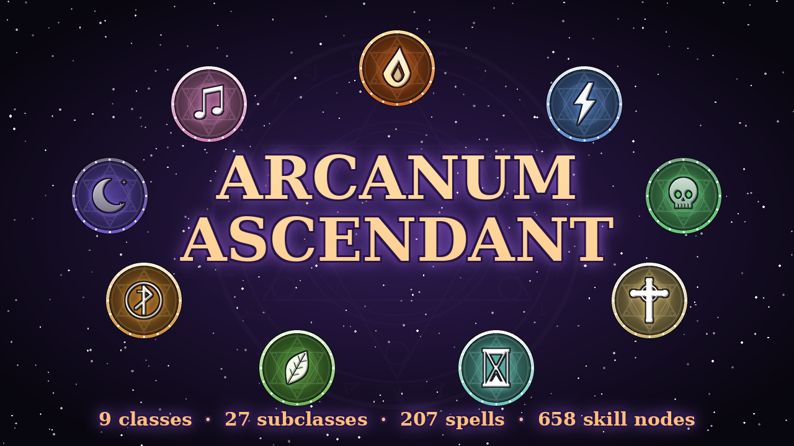

# Arcanum Ascendant: Magic & Classes for RimWorld 1.6

A magic and class system for RimWorld with **14 classes, 42 subclasses, 424 spells and 1170 skill tree nodes**. Every class and every subclass has its own skill tree, and it doesn't depend on any other mod (not even Harmony).

- **Five attributes**: Potency, Focus, Celerity, Resilience and Attunement. They power your spells and gate the deeper rows of every tree.
- **Branching skill trees**: spells, augments that change how a spell behaves, multi-rank passives, mutually exclusive keystones and a subclass ultimate.
- **Psycast-style awakening**: colonists don't get magic for free. Scribe a *grimoire of awakening* from arcane crystals, have a colonist read it, then let them study at an *arcane lectern* until their gift awakens. Psychic sensitivity and intellect speed it up, and the psychically deaf can't attune at all.
- **Five arcane circles**: levels 1-30 come from fighting, casting, healing and study. At levels 6, 12, 18 and 24 experience stops until the mage shatters an *ascension sigil* to break through to the next circle. Subclasses open at the Second Circle and ultimates need the Fifth. After level 30, paragon levels continue slowly.
- **Endgame spells for endgame threats**: true damage, damage based on a percentage of the target's vitality, executes, shield shattering, mechanoid shutdowns, black holes, time stop, mass mind control and spells that scale with "boss" size. They're built for heavily armored late-game faction mods.
- **Utility and quirky spells**: make colonists young again (each casting cures an ailment of age, fades a scar or regrows a limb), age enemies until they crumble to dust, repair and un-rot items, raise an item's quality to legendary, turn weakened enemies into solid gold, call down ore meteorites, steal skills from prisoners, make it rain, turn rock into steel or silver, grow crops, tame every animal in sight, polymorph raiders into chickens, and scatter banana peels.
- **Five mythic classes** built around a signature mechanic each: the **Harbinger** lays Omens until the Seventh Seal breaks, the **Wind Mage** really throws enemies through the air and into walls, the **Succubus** (women) and **Incubus** (men) enthrall enemies or put them in debt, and the **Noclipper** drops enemies out of reality and builds Backrooms mazes around them. See [The mythic classes](#the-mythic-classes).
- **Summons**: risen dead, wolves, bears, a thrumbo, megascarabs, hellhounds, Backrooms Hounds and Partygoers, a Skin-Stealer copy of an enemy, turrets, a Magma Titan, a Rune Colossus, and walls of ice, bone, thorns, runes, wind and yellow wallpaper.
  - Raised and mind-controlled people join your colony for as long as the spell lasts. Draft them and give orders like any colonist. When undrafted they guard their mage. Summoned beasts guard their mage too, and the mage gets a **Command summons** button that sends them all at a target.
- **A full effects engine**: every school of magic has its own look, from the casting circle that builds under the mage to the projectile, the impact, the ground it scars and the way enemies die. Spells light up the night, leave scorch marks and frost behind, and ultimates get a cinematic name card. See [Visual effects](#visual-effects).
- **Elemental reactions**: combine schools for bonus effects. Freeze an enemy, then hit them with fire or force to **Shatter** them. Fire on a shocked target **Overloads**, and holy light **Purges** a curse. There are twelve reactions to discover.
- **Spell mastery**: every spell levels up separately as you cast it, from Apprentice to Grandmaster, with stars on its button.
- **Overchannel**: cast without enough mana by burning your own mind. Strain builds up, wild surges go off, and pushing too far burns the mage out for a day.
- **Familiars**: bond an ember sprite, frost wisp, shadow raven, lumen, clockwork owl, void eye or pocket dragon. Each one circles its mage, gives a lasting bonus and joins fights.
- **New spell forms**: homing missile swarms, blades and suns that orbit the caster, channelled beams you hold on a target, and delayed strikes telegraphed on the ground.
- **Arcane buildings**: a **ward pylon** whose dome stops incoming bullets, and a **mana font** that speeds up mana regeneration for mages nearby. The arcane lectern has a proper view for each direction you place it in.
- **Sound**: 90 synthesized sound effects, from church bells and crow calls to fluorescent hum.
- **Grimoire UI**: a zoomable skill-tree screen, an attribute panel, a spellbook with autocast and hide toggles, a subclass picker with tree previews, and a codex.
- **Enemy mages**: raiders can be awakened too, and they cast their spells at you.
- **Fully configurable**: XP rate, mana regeneration, spell power, enemy mage frequency and level, and every visual effect can be scaled or turned off.

The full list of every spell and keystone is in **[docs/Compendium.md](docs/Compendium.md)**.

---

## Installation

**Requires RimWorld 1.6.** No other mods are needed.

1. **Download** the mod. On this GitHub page click the green **Code** button, then **Download ZIP**.
2. **Extract** the ZIP into your RimWorld `Mods` folder. The extracted folder (for example `rimworld-magic-mod-main`) should sit directly inside `Mods`:
   - **Windows (Steam):** `C:\Program Files (x86)\Steam\steamapps\common\RimWorld\Mods\`
   - **Mac (Steam):** `~/Library/Application Support/Steam/steamapps/common/RimWorld/RimWorldMac.app/Mods/`
   - **Linux (Steam):** `~/.steam/steam/steamapps/common/RimWorld/Mods/`
   - **GOG/DRM-free:** the `Mods` folder next to the game executable.
3. **Enable** it. Start RimWorld, open **Mods**, tick **Arcanum Ascendant - Magic & Classes**, and restart when the game asks. Load order doesn't matter much; putting it after Core and the DLCs is fine.

That's it. You can add it to an existing save.

> Folder check: the mod is installed correctly if `Mods/<folder>/About/About.xml` and `Mods/<folder>/1.6/Assemblies/ArcanumAscendant.dll` both exist.

---

## Getting started

1. **Find arcane crystals.** Mine violet *ley crystal veins* in mountains, drill for them with a deep drill, buy them from exotic traders and outlander or tribal settlements, or take them from enemy mages you kill.
2. **Research *Arcanology*** and build an **arcane lectern**. Scribe a **grimoire of awakening** there (8 arcane crystals, 60 silver, 25 cloth, Intellectual 6).
3. **Attune a colonist.** Have them read the grimoire. They then need about 16 hours of study at the lectern; they study in their free time, or you can right-click the lectern to order it. Psychic sensitivity and Intellectual skill speed this up. When attunement completes, click **Awaken magic** and choose a class. Women see the Succubus and men the Incubus; people without a gender can take either.
   - Rarely, a colonist's gift wakes on its own.
   - If you'd rather skip all this, turn on **Free awakening** in the mod settings.
4. **Open the grimoire.** Mages get a status panel showing mana, ward and XP. Click it to open the grimoire:
   - Spend **attribute points** in the left panel. You get one per level.
   - Spend **perk points** in the skill tree. Click a glowing node to learn it. A node needs a learned node connected above it, and deeper rows need levels and your primary attribute.
5. **Cast spells.** Learned spells appear as buttons on the command bar. Combat spells show while the mage is drafted; utility, heal and buff spells show at all times. Spell buttons display their mana cost.
6. **Ascend.** At level 6 the mage's experience bar turns gold and stops filling. Etch a *sigil of the Second Circle* at the lectern and have them shatter it. Higher sigils need more crystals, gold and research (*Higher Arcana*, *Arcane Mastery*, *Archmagic*).
7. **Choose a subclass at the Second Circle.** Open the grimoire's Subclass tab, preview the three trees, and commit to one.
8. **Turn on autocast.** Right-click a spell button, or use the Spellbook tab. Drafted mages then cast those spells on their own. Healing spells can also autocast while undrafted.

### Tips
- Mages gain experience faster from real fights than from study. Killing non-hostile creatures gives almost nothing.
- **Ward** is an arcane barrier that absorbs damage before your health does. It regenerates once you've gone 5 seconds without taking damage. Resilience and level increase it.
- **Mana draughts** restore mana instantly. Brew them at the Arcane Lectern.
- A **Tome of Unmaking** (requires the *Higher Arcana* research) refunds every point you've spent, so you can rebuild.
- Keystones in the same row are mutually exclusive. They define your build.
- Hover any node or spell for an exact tooltip showing current and next-rank numbers and your real damage multiplier.
- In developer mode, a **DEV: Arcanum** button lets you test anything: awaken, add levels, learn every node, reset cooldowns.

---

## Deeper magic

### Elemental reactions
When a spell hits a target that already carries the right status, the two combine. The first time a reaction happens you get a letter, and it's recorded in the grimoire's Codex. Until then the Codex only shows a hint.

| Reaction | How to trigger it | What it does |
|---|---|---|
| **Shatter** | Fire, force or crushing damage on a **frozen** target | Heavy damage that ignores armor, and it sunders their armor |
| **Steam Burst** | Frost on a **burning** target | Scalding steam burns everyone nearby and blinds them |
| **Overload** | Fire on a **shocked** target | An explosion that burns and stuns everyone around |
| **Superconduct** | Lightning or EMP on a **chilled or frozen** target | Arcs to everyone nearby, shocking them and stripping their armor |
| **Wildfire** | Fire on a target **entangled** in roots or thorns | Everyone in the tangle catches fire |
| **Purge** | Holy damage on a **cursed or plagued** target | Tears the curse out, deals heavy radiant damage, and stuns |
| **Time Fracture** | Void damage on a target in **slowed or looping** time | Huge damage that ignores armor, and a long stun |
| **Resonance** | Sound or force on a target turned to **ice, stone or gold** | They shatter from within |
| **Necrotic Bloom** | Necrotic damage on a **bleeding** target | Poison bursts over everyone nearby and heals the caster |
| **Boiling Blood** | Fire on a **bleeding** target | Brutal damage and a stagger |
| **Twilight** | Shadow damage on a target **marked** by holy judgment | A burst that ignores armor and gives the caster mana |
| **Entropy Cascade** | Temporal damage on a **withering** target | Heavy damage that ignores armor, plus years of ruin on the body |

Mixed parties pay off: a Frostwarden freezes a target, then a Forgeheart's **Hammerfall** shatters it.

### Spell mastery
Every spell a mage casts earns mastery points for that spell. Long-cooldown spells and ultimates earn more per cast. There are five ranks: Apprentice, Adept, Expert, Master and Grandmaster. Each rank gives +4% damage and healing and -3% mana cost and cooldown. Expert also adds +10% radius and duration. Grandmaster adds one extra target and +10% critical chance. Mastery shows as stars on the spell's button and as a progress bar in the Spellbook.

### Overchannel, strain and wild surges
Turn on **Overchannel** (the toggle next to a mage's spells) and they can cast spells they don't have the mana for. Each missing point of mana becomes **arcane strain**, which brings pain, slows thinking and makes mental breaks more likely. Strain fades over time, and faster out of combat.
- Above 40 strain, every overchannelled cast can set off a **wild surge**. There are twelve: a flood of mana, every cooldown resetting, a stray bolt of lightning, a blink, a storm of petals, a nosebleed, and more.
- At 120 strain the mage **burns out**. For a full day, no mana regenerates and spell power is halved.
- Autocast never overchannels. Taking on strain is always your call.

### Familiars
Craft a **familiar vessel** at the arcane lectern (15 arcane crystals and 10 gold, *Higher Arcana*, Intellectual 8). A mage of the Second Circle or higher can break it open (right-click it) and choose a familiar. Breaking another vessel later replaces the old familiar.

| Familiar | In a fight | Lasting bonus |
|---|---|---|
| Ember sprite | Spits fire that leaves the target burning | +5% spell power |
| Frost wisp | Darts of frost that chill | +15 maximum ward |
| Shadow raven | Dives at enemies' eyes and blinds them | +4% critical chance |
| Lumen | Heals the most injured ally nearby | +10% healing power |
| Clockwork owl | Rebuilds its mage's ward | -5% cooldowns, +8% cast speed |
| Void eye | Beams of nothing that leave enemies voidtouched | +6% spell power, +8% critical damage |
| Pocket dragon | Breathes fire on an enemy and everyone right next to them | +15 maximum mana |

### Arcane buildings
- **Ward pylon** (Security tab, *Higher Arcana*): projects a dome with a radius of about 7 cells. Bullets and other projectiles fired from outside stop dead against it, while your own shots pass out freely. The dome soaks 400 damage before it collapses and needs time to reform. EMP silences it for a while.
- **Mana font** (Misc tab, *Arcanology*): mages within 8 cells regenerate 1.5 extra mana per second. You can watch the mana stream into them.

---

## The classes

| Class | Fantasy | Subclasses |
|---|---|---|
| **Pyromancer** | Burst fire damage and burning | Inferno Lord (area devastation), Ashen Phoenix (healing fire and rebirth), Forgeheart (molten armor and fire constructs) |
| **Tempest** | Lightning chains, frost and wind | Stormcaller (anti-mech lightning), Frostwarden (freeze and shatter), Skybreaker (tornadoes and weather) |
| **Necromancer** | Drain life, raise and explode the dead | Lich (deathless caster, Finger of Death), Bonelord (undead legions), Plaguebringer (spreading plague) |
| **Paladin** | Holy tank and healer | Templar (front-line knight), Cleric (mass healing and resurrection), Inquisitor (purge, silence, final judgment) |
| **Chronomancer** | Haste, slow and stopped time | Timeweaver (squad buffs, Eternity), Voidwalker (gravity wells, Singularity), Paradox (undo deaths, erase enemies) |
| **Druid** | Nature, beasts and farming | Beastmaster (bears, wargs, thrumbo), Verdant Warden (healing groves, World Tree), Shapeshifter (bear, wolf and thrumbo forms) |
| **Runesmith** | Turrets, wards and transmutation | Golemancer (construct army), Spellforger (enchanting allies), Arcane Gunslinger (runic gunplay) |
| **Shadowmancer** | Hexes, stealth and terror | Assassin (backstab, Death Lotus), Hexer (curses and chickens), Hemomancer (blood magic) |
| **Spellsinger** | Music: buffs, sleep, mood | Skald (war songs), Illusionist (charm and recruit), Jester (chaos magic and pies) |
| **Harbinger** | Omens and the Seventh Seal | Doomsayer (prophecy, shared fate, the Apocalypse), Pale Rider (reaping and harvesting souls), Cataclysm (earthquakes, Wormwood, the Seven Seals) |
| **Wind Mage** | Throw enemies, steal their breath, stop bullets | Windblade (blinking blade dancer), Pressure Sage (crushing pressure, Dead Air), Skywarden (domes of wind, rescues) |
| **Succubus** (women) | Infatuation, enthralment, stolen youth | Temptress (domination), Thief of Years (age drain and rejuvenation), Nightmare Muse (sleep and dreams) |
| **Incubus** (men) | Debt, contracts, hellfire | Pactbinder (usury and foreclosure), Dreamlord (possession and nightmares), Hellprince (infernal form and hellgates) |
| **Noclipper** | The Backrooms | Level Keeper (mazes, rooms and the Poolrooms), Entity Handler (Hounds, Partygoers, Smilers, Skin-Stealers), Archivist (cursed tape, rewinds, exit signs) |

See the [Compendium](docs/Compendium.md) for every spell, its cost, cooldown and description.

### The mythic classes

Each of the five newest classes is built around a stacking mechanic that pays off in its own way:

| Class | Mechanic | What happens |
|---|---|---|
| **Harbinger** | **Omens** | Crows, prophecies, curses and even your allies' gunfire (on a *Fated* enemy) lay Omens. At seven the **Seventh Seal** breaks: damage that ignores armor and scales with the victim's own vitality, and its Omens scatter to everyone nearby, so one seal can set off the next. *Toll the Bell* and *Last Rites* spend Omens for burst damage instead. Bosses need ten. |
| **Wind Mage** | **Real throws** | *Gust*, *Hurl*, *Updraft* and *Sky Toss* launch enemies through the air. The farther they fly, the harder they land, and hitting a wall is a **wall slam**. *Vacuum Bubble* suffocates and silences, and *Wind Wall*, *Aegis of Gales* and *Heaven's Bulwark* tear apart bullets fired into them and can throw the force back. |
| **Succubus** | **Infatuation** | At five stacks the target is **Enthralled** and fights for her for twenty seconds. Bosses are stunned instead. *Heartbreak* and *Stolen Heartbeat* spend stacks for damage, and *Kiss of Youth* keeps her young. |
| **Incubus** | **Debt** | At five Debts he **collects**: hellfire, a share of the victim's vitality and the weapon out of its hands. *Devil's Due* calls in every Debt on the map at once. *Infernal Contracts* make an ally monstrously strong, if they deliver two kills in time. |
| **Noclipper** | **Lost** | At four stacks the target **noclips out of reality** for six seconds and comes back wandering. *Level 0* raises a maze of yellow wallpaper around a whole squad, the *Door to Nowhere* swallows anyone who walks past, and *Bleed Through* sends every enemy on the map into the Backrooms. |

---

## Visual effects

The effects run on the mod's own particle, decal and lighting systems, built on the game's own rendering. They don't use custom shaders, and they don't touch the game's random numbers, so they can't change the outcome of a fight.

- **Signature looks for each school.** Fire throws streaking sparks, rising embers and black smoke, and leaves scorch marks. Frost bursts into ice shards and creeping frost. Storm uses forked lightning that branches and strikes again. Necromancy raises wisps and grinning skulls and leaves rot on the ground. Holy magic falls in shafts of light. Time magic uses clock faces and slowed sparks, Void uses implosions and dark rifts, and Song uses rings and music notes. Wind magic throws gusts, leaves and dust; Doom brings crows, burning seals and watching eyes; Desire scatters hearts, petals and kisses; and the Liminal school glitches, flickers and hums like a fluorescent tube.
- **Casting circles.** While a mage casts, a circle in their school's style builds under their feet and a charge gathers in their hand. Ultimates add a second outer ring and the ground shakes.
- **Projectiles with real trails.** Every projectile has a ribbon trail, a smoke trail for fire, a muzzle flash and its own head glow. Homing missiles curve toward their targets.
- **Impacts by school, with ground marks.** Craters, scorch, frost, cracks, blood, rot, glowing glyphs and void stains slowly fade from the ground.
- **Dynamic light.** Fireballs, lightning and holy light really light up their surroundings at night and underground.
- **Telegraphed strikes.** Meteors, delayed strikes and barrages mark the ground with a warning circle that fills until they land.
- **Status visuals.** Burning, frozen, shocked, poisoned, cursed, rooted, petrified, gilded and more each have their own look on the affected pawn.
- **Death effects.** A fire kill goes up in embers and ash, a frost kill bursts into ice shards, necromancy pulls the soul back to the caster, and holy light raises a pillar and drifting feathers.
- **Floating combat text.** Damage numbers (critical hits are bigger), healing numbers, and callouts for reactions such as "SHATTER!"
- **Ultimates.** A screen flash, a shockwave, a pillar of light, and a cinematic card with the spell's name.
- **It scales.** Particle counts adapt to zoom level and to the intensity slider, and every element can be switched off in the mod settings.

---

## Mod settings

Options → Mod Settings → Arcanum Ascendant:

| Setting | Default |
|---|---|
| Experience gain | 100% |
| Mana regeneration | 100% |
| Spell power | 100% |
| Free awakening (no grimoire or study needed) | Off |
| Starting colonists begin awakened | Off |
| Allow autocast | On |
| Chance for hostile people to be mages | 6% |
| Enemy mage level scaling | 100% |
| Enemy mages cast spells | On |
| Newly learned combat spells start with autocast | On |
| Elemental reactions | On |
| Visual effect intensity | 100% |
| Screen shake | On |
| Dynamic spell lighting | On |
| Screen flashes | On |
| Cinematic ultimates | On |
| Damage numbers | On |
| Ground marks | On |

If you play on a slower PC, lower **Visual effect intensity** first. It reduces particle counts everywhere.

---

## Compatibility

- RimWorld **1.6**. Works with or without any DLC.
- It doesn't patch game code (no Harmony), so conflicts are very unlikely.
- It works with modded humanlike races: every race gets the arcane component at startup.
- It's safe to add mid-save. Mages from saves made before the circle system are converted automatically: their level is rescaled and all their points are refunded so you can rebuild. To remove it, first un-awaken your mages from the dev tools, or start a new save.

---

## Building from source (for modders)

You only need this if you want to change the mod. The repository already contains the compiled DLL, the textures and the sounds.

- **C# assembly:** `Source/ArcanumAscendant/` compiles against `Krafs.Rimworld.Ref` (NuGet) with the .NET SDK and writes to `1.6/Assemblies/`.
- **Content:** classes, spells and skill trees are written in compact Python in `Tools/gen/classes/*.py`. `python3 Tools/gen/build.py` turns them into XML in `Defs/Generated/` and regenerates `docs/Compendium.md`.
- **Art:** `python3 Tools/art/make_textures.py` renders every icon, sprite and effect texture procedurally (needs numpy and pillow).
- **Audio:** `python3 Tools/audio/make_sounds.py` synthesizes every sound effect.
- **Validation:** `Tools/validator` loads the compiled assembly and RimWorld's reference assemblies through reflection. It checks every XML field name, class, enum value and def reference.
- `Tools/build_all.sh` runs all of the above in order.

Adding a spell is about ten lines of Python: pick a delivery (projectile, beam, chain, cone, nova, barrage, line, meteor, homing missiles, orbitals, channel or delayed strike) and compose effects (damage, heal, hediff, field, summon, teleport, polymorph and dozens more). Each spell gets a visual style from its school automatically, and you can override it with `style=`. Reactions and familiars are plain defs in `Tools/gen/systems.py`.
